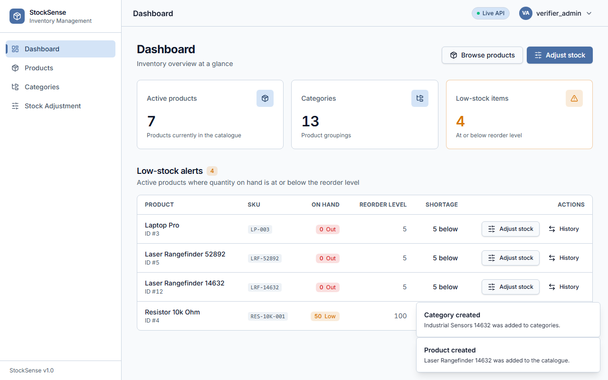
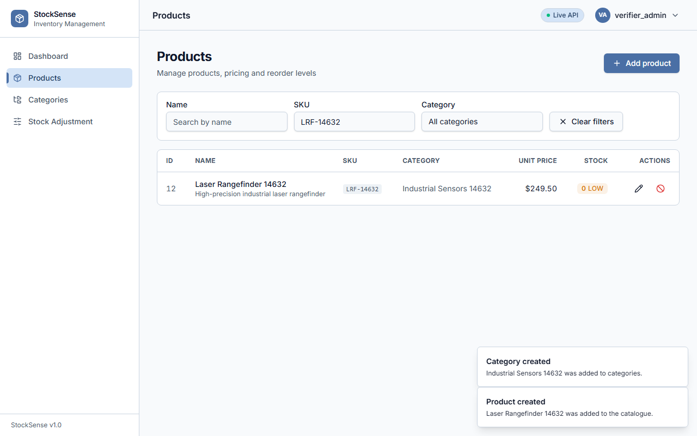
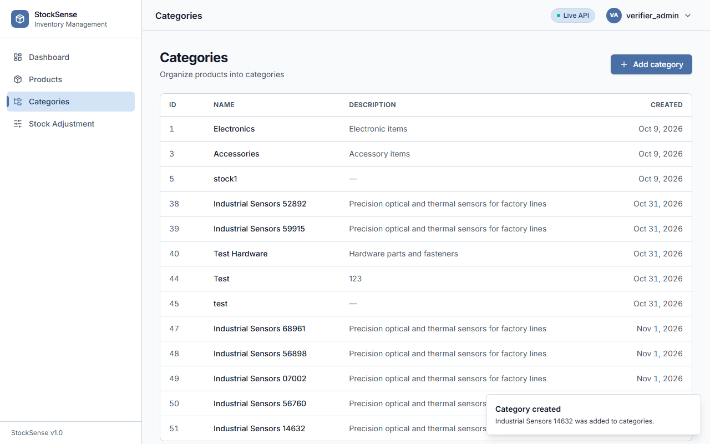
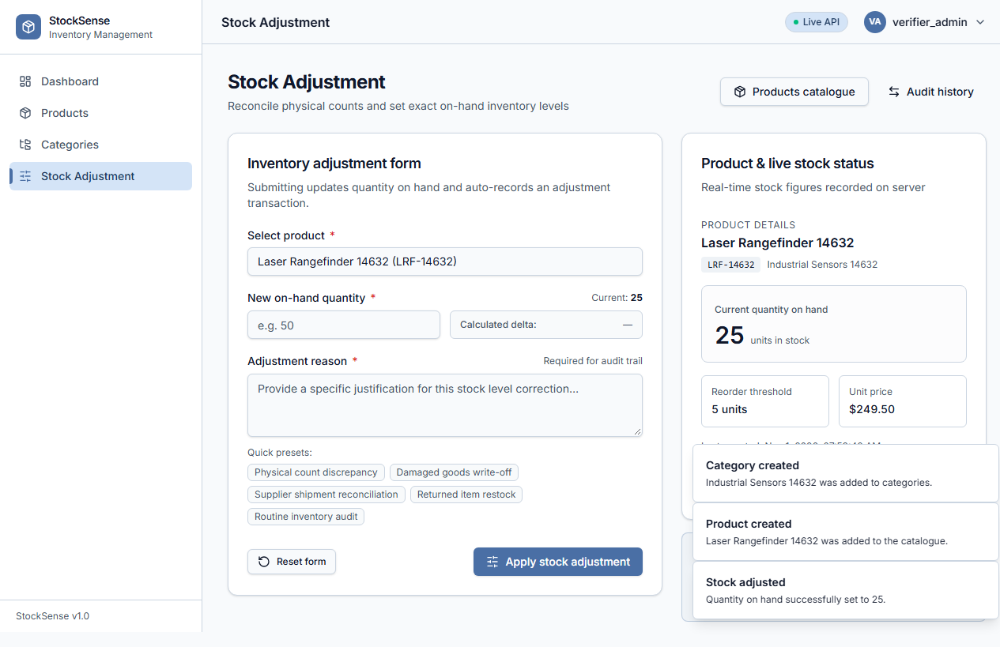
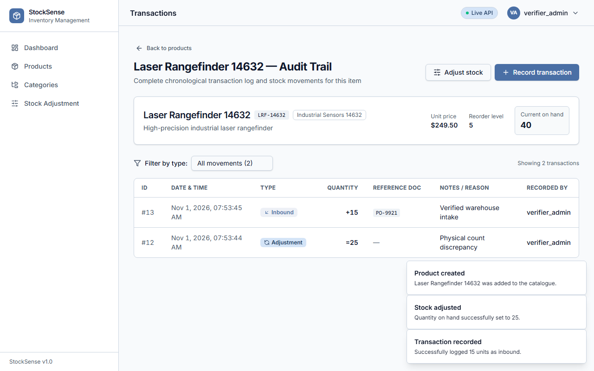
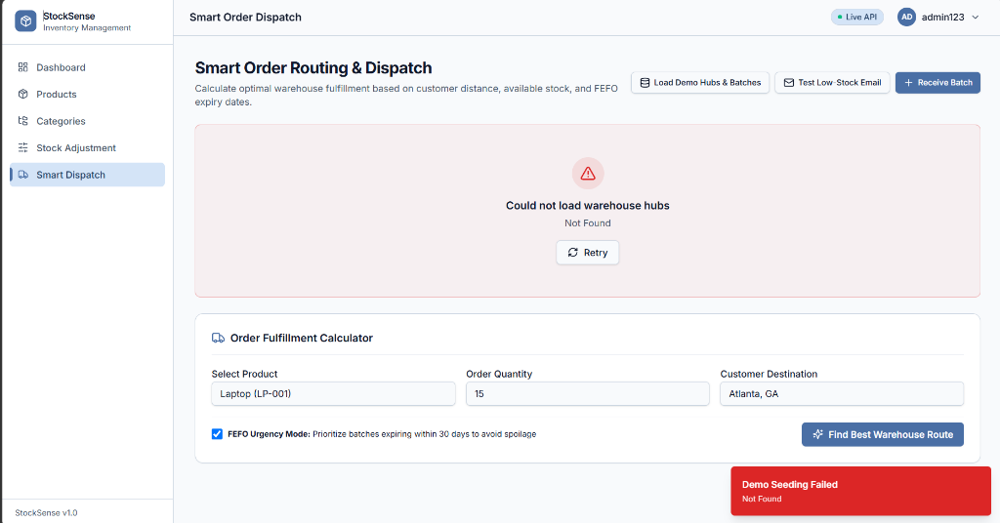
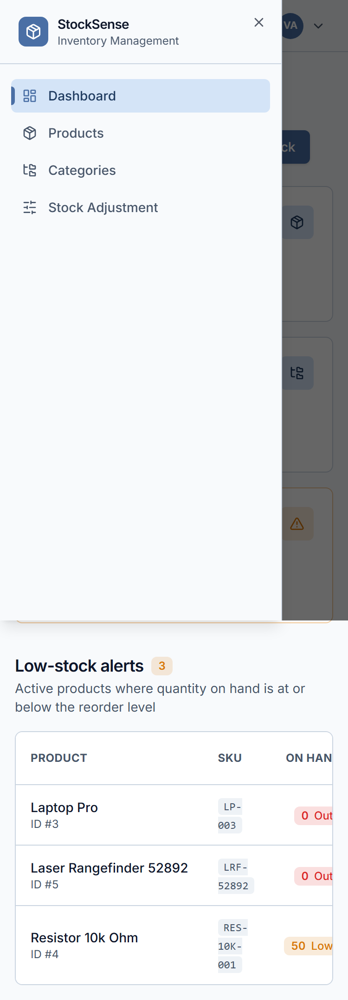

# StockSense — Modern Inventory Management System

A high-performance, responsive inventory management application built for modern supply chain operations. StockSense combines an asynchronous **FastAPI + PostgreSQL** backend with a modern **React 19 + TypeScript + Tailwind CSS v4** frontend styled using the high-contrast **Arctic Frost** design system.

---

## Live Demo & Architecture

- **Frontend (Vercel CDN)**: React 19 Single Page Application with client-side SPA routing (`vercel.json`)
- **Backend (Render Cloud)**: FastAPI running on Python 3.12 with async SQLAlchemy & Uvicorn:  
  `https://stocksense-backend-zv2d.onrender.com`
- **Database (Render PostgreSQL)**: Managed cloud PostgreSQL database with Alembic migration versioning

```
┌──────────────────────────────────────┐
│          Client Browser              │
│  (Desktop, Tablet, or 375px Mobile)  │
└──────────────────┬───────────────────┘
                   │
         HTTPS (Vercel CDN)
                   ▼
┌──────────────────────────────────────┐
│       StockSense Frontend            │
│  • React 19 + TypeScript + Vite      │
│  • Tailwind CSS v4 + Arctic Frost    │
│  • TanStack Query v5 + Axios Client  │
│  • React Hook Form + Zod             │
└──────────────────┬───────────────────┘
                   │
       REST API (OAuth2 Bearer)
                   ▼
┌──────────────────────────────────────┐
│        FastAPI Cloud Backend         │
│  • Async SQLAlchemy 2.0 (asyncpg)    │
│  • JWT Auth + Role-Based Access      │
│  • Alembic Schema Migrations         │
│  • Docker Container on Render        │
└──────────────────┬───────────────────┘
                   │
           SQL Connection
                   ▼
┌──────────────────────────────────────┐
│     PostgreSQL 16 Database           │
│  • Products, Categories, Stock,      │
│    Transactions & Users              │
└──────────────────────────────────────┘
```

---

## Visual Tour & Key Features

### 1. Dashboard & Real-Time Stock Analytics
The central command view displays real-time inventory health KPIs, categorized inventory metrics, and a prioritised **Low-Stock Alert List** with direct adjustment actions.



- **KPI Metric Cards**: Real-time counts for Active Products, Total Categories, and Low Stock Alert Items.
- **Shortage Ranking**: Automatically flags items at or below reorder levels with visual `Out of Stock` and `Low Stock` status tags.
- **Direct Action Links**: One-click navigation to immediately record adjustments or inspect audit logs for flagged items.

---

### 2. Product Catalog & Live Stock Fan-Out
A dense, high-contrast inventory grid combining product metadata, client-side category resolution, and per-row live stock levels.



- **Client-Side Joins**: Instant category lookup via cached category maps.
- **Batched Stock Inquiries**: Visible table rows fan out non-blocking live stock queries with localized skeleton loaders.
- **Live Search & Category Filtering**: Instant filtering by product name, SKU, or category.
- **Soft Deactivation**: Prevents accidental hard deletion; deactivated products preserve audit integrity.

---

### 3. Categories Management & Conflict Prevention
Organize items by categories with built-in uniqueness checks and robust conflict resolution.



- **Duplicate Name Guard**: Case-insensitive client validation paired with backend constraint error mapping (`A category with this name already exists`).
- **Paginated Listing**: Clean pagination controls with tri-state handling (Loading, Empty, and Error states).

---

### 4. Precision Stock Adjustment
A dedicated workflow for inventory counts and warehouse adjustments with real-time delta calculation.



- **Real-Time Delta Badge**: Computes exact unit discrepancy ($\Delta = \text{new} - \text{current}$) live as values are entered.
- **Reason Presets**: One-click quick notes (*"Physical stock count"*, *"Damaged goods"*, *"Supplier correction"*).
- **Automated Audit**: Server automatically logs an adjustment transaction without client-side double counting.

---

### 5. Product Transaction Audit Trail
Complete, immutable ledger tracking all inbound receipts, outbound sales, returns, and physical adjustments.



- **Complete Audit Record**: Timestamped movements, reference document tags, operator usernames, and remarks.
- **Movement Type Filter**: Instant filtering by Inbound, Outbound, Adjustment, or Return.
- **Overdraft Guard**: Client-side validation stops outbound requests that exceed current on-hand quantities before network submission.

---

### 6. Multi-Warehouse Management & Batch Expiration Tracking (FEFO)
Scale beyond single-warehouse limits with distributed regional fulfillment hubs and granular lot/batch expiration control.

- **Regional Warehouse Hubs**: Distributed warehouses modeled with real geographic coordinates (`latitude`, `longitude`, `city`, `code`) across major logistics corridors (e.g. East Coast Hub `WH-EAST` in Newark NJ, Central Hub `WH-CENT` in Dallas TX, and West Coast Hub `WH-WEST` in Fresno CA).
- **Batch & Lot Level Traceability**: Perishables and shelf-life-sensitive inventory are tracked via `StockBatch` records storing `batch_number`, `quantity`, and `expiry_date`.
- **FEFO (First-Expired, First-Out) Invariant**: When fulfilling dispatches or inspecting batch stock, the system prioritizes batches with the nearest expiration date, preventing inventory spoilage and write-offs.
- **Per-Product Warehouse Breakdown Modal**: Click the warehouse building icon on any product in the catalog to open an interactive dialog displaying stock distribution and expiration countdown badges across all fulfillment hubs.

---

### 7. Smart Order Dispatch & Automated Low-Stock Email Alerts
An intelligent routing engine that pairs physical geography with inventory perishability to calculate the optimal fulfillment hub in milliseconds.



- **Smart Routing Engine**:
  - **Haversine Geodetic Math**: Calculates great-circle physical distance in kilometers between customer delivery coordinates and regional warehouse hubs.
  - **Transit Time Estimation**: Computes estimated ground freight delivery duration ($\approx 600\text{ km/day}$).
  - **Multi-Factor Scoring & FEFO Urgency**: Balances delivery speed with batch freshness. When **FEFO Urgency Mode** is active, warehouses with batches expiring within 30 days receive a dynamic priority bonus so urgent stock is dispatched before fresher inventory.
  - **Transparent Explanations**: Generates plain-English reasons for why a warehouse is recommended (e.g. *"FEFO Priority: Dispatches batch LOT-2026-B01 expiring in 18 days while still reaching Chicago in ~2 days"*).
- **One-Click Order Fulfillment**:
  - Automatically deducts order quantity from the earliest-expiring batches in the selected warehouse.
  - Keeps aggregate product stock (`Stock.quantity_on_hand`) synchronized in real time.
  - Generates an immutable `OUTBOUND` transaction with lot numbers and destination notes in the audit trail.
- **100% Free Low-Stock Email Alerts**:
  - Evaluates remaining inventory against the product's `reorder_level` immediately upon dispatch or adjustment.
  - Dispatches an automated HTML alert email with a complete warehouse breakdown table via standard Python `smtplib` (compatible with free Gmail SMTP App Passwords).
  - Includes a zero-config **Safe Demo Mode** that safely logs formatted alerts to the console and UI if SMTP credentials are not configured, guaranteeing zero runtime crashes.

---

### 8. Mobile Usability & Responsive Polish (375px+)
Engineered to work seamlessly on phones and handheld warehouse scanners down to 375px viewport widths.



- **Zero Horizontal Wobble**: Container-constrained horizontal table scroll prevents whole-page viewport blowout.
- **Slide-out Navigation**: Mobile sheet drawer with top brand header that never overlaps close controls.
- **WCAG 2.1 AA Compliance**: Strict landmark semantics (`<main>`, `<h1>`), high-contrast focus rings, and full keyboard navigation.

---

## Tech Stack & Design Choices

| Layer | Technology | Details |
|---|---|---|
| **Frontend Framework** | **React 19** + **TypeScript** | Strict type-safety (`strict: true`, zero `any`), React Router v6 |
| **Styling & Design** | **Tailwind CSS v4** + **shadcn/ui** | Pure CSS-first `@theme` with **Arctic Frost** palette (high contrast table borders `#cbd5e1`, steel blue `#4a6fa5`, slate secondary `#475569`) |
| **Data Fetching** | **TanStack Query v5** + **Axios** | Centralized query keys, automatic cache invalidation, Bearer auth interceptor, 401 redirect loop protection |
| **Forms & Validation** | **React Hook Form** + **Zod** | Client-side schema parity with backend Pydantic models |
| **Backend Framework** | **FastAPI** + **Python 3.12** | Async handlers, Pydantic validation, OAuth2 password request flow |
| **Database & ORM** | **PostgreSQL 16** + **SQLAlchemy 2.0** | Async database access via `asyncpg`, schema migrations via `alembic` |
| **Smart Routing & Alerts** | **Haversine Geodesic Math** + **Python smtplib** | Multi-warehouse order routing, FEFO batch prioritization, and free Gmail SMTP low-stock email triggers |
| **Container & Cloud** | **Docker** + **Render** + **Vercel** | Multi-stage Docker build, zero hardcoded URLs, SPA rewrites |

---

## Local Development Setup

### Prerequisites
- Node.js 20+ and npm / pnpm
- Python 3.12+ (or Docker Desktop)
- PostgreSQL 16 (or Docker Compose)

### 1. Clone Repository
```bash
git clone https://github.com/Abhaysint/Prod_Inventory_Management.git
cd Prod_Inventory_Management
```

### 2. Start Backend & Database (via Docker)
```bash
docker compose up -d
# View backend logs:
docker compose logs -f app
```
The FastAPI backend will be available at `http://localhost:8000` (API docs at `http://localhost:8000/docs`).

### 3. Run Frontend
```bash
cd frontend
npm install
npm run dev
```
Open `http://localhost:5173` in your browser.

---

## Verification & Quality Commands

```bash
# Type check without compilation emit
cd frontend
npx tsc -b

# ESLint audit (0 errors, 0 warnings enforced)
npm run lint

# Production build test
npm run build
```

---

## Security & Deployment Hygiene

- **Secret Isolation**: All `.env*` files are strictly gitignored (`!.env.example` template provided).
- **Zero URL Hardcoding**: All routes originate from `API_ENDPOINTS` in `src/api/endpoints.ts`, and base URLs are parsed through `src/lib/env.ts` which sanitizes trailing slashes.
- **Role-Based Access Control**:
  - `admin`: Full access to products, categories, users, adjustments, and transactions.
  - `manager`: Catalog creation, updates, and stock transactions.
  - `viewer`: Read-only access across all inventory dashboards.

---

## License
MIT License. Built for production inventory management.

